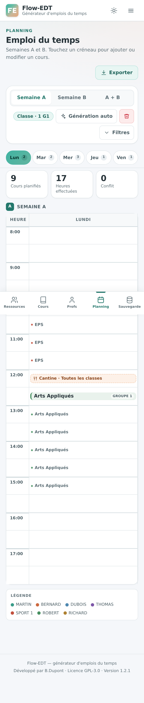

# Flow-EDT

Générateur d'emplois du temps pour établissement scolaire, en **un seul fichier HTML**, sans serveur, sans compte et sans dépendance.

[](LICENSE)
[](index.html)


## Sommaire

- [Fonctionnalités](#fonctionnalités)
- [Démarrage](#démarrage)
- [Génération automatique](#génération-automatique)
- [Applications de bureau](#applications-de-bureau)
- [Données et sauvegarde](#données-et-sauvegarde)
- [Qualité](#qualité)
- [Structure du projet](#structure-du-projet)
- [Développement](#développement)
- [Licence](#licence)

## Fonctionnalités

**Ressources** — professeurs, salles, classes, demi-groupes et groupes de classes, avec volumes horaires et effectifs.

**Cours** — catalogue complet : classe, professeur, salle, nombre d'heures, semaines A/B, priorités, plages horaires interdites, durée et contraintes de salle dédiée.

**Professeurs** — un écran dédié pour composer un service sans quitter la page : choix du professeur, volume horaire hebdomadaire, puis ajout de ses cours classe par classe. Le planning se met à jour en direct.


**Emploi du temps** — grille 6 jours × créneaux, semaines A et B, trois vues ciblées : par professeur, par classe (demi-groupes et groupes inclus) ou par salle. Le planning s'ouvre directement sur une ressource, sans vue globale. Détection des conflits en temps réel : un professeur, une classe ou une salle ne peuvent jamais être occupés deux fois au même créneau.

**Confort de lecture** — mode compact des tableaux (mémorisé), bascule clair/sombre, cartes de cours légèrement décalées quand un créneau en contient plusieurs, aperçu détaillé du créneau au survol (ou appui long au doigt), export PDF et CSV, impression.

**Mobile** — menu burger, barre de navigation inférieure, feuilles modales, tableaux compacts ; toutes les fonctions restent accessibles en 390 px.

## Démarrage

1. Téléchargez `index.html` (ou clonez le dépôt).
2. Ouvrez-le dans un navigateur moderne : double-clic, ou `xdg-open index.html`.
3. Créez vos ressources puis vos cours — **l'application démarre totalement vide**, aucune donnée de démonstration.

Aucune installation, aucun serveur, aucune connexion réseau : tout s'exécute dans le navigateur.

<table>
<tr>
<td width="50%"></td>
<td valign="top">

**Compatibilité** — Chrome, Edge, Firefox et Safari récents. L'application est un fichier autonome ; les données restent sur le poste (aucun envoi).

**Accessibilité** — navigation clavier, rôles ARIA sur les onglets, les feuilles et les sélecteurs, libellés explicites et focus visible.

</td>
</tr>
</table>

## Applications de bureau

Trois paquets autonomes sont produits à partir du même `index.html` (Electron) : l'application se comporte exactement comme dans le navigateur, les données restent dans le profil local de l'utilisateur (aucune connexion réseau, aucune télémétrie).

| Paquet | Cible | Format |
|---|---|---|
| `FlowEDT-<version>-x86_64.AppImage` | Linux x86-64 | image exécutable, ~111 Mo |
| `FlowEDT-<version>-windows-x64-setup.exe` | Windows 10/11 x64 | installation par utilisateur (NSIS), ~107 Mo |
| `FlowEDT-<version>-windows-x64-portable.zip` | Windows 10/11 x64 | archive à décompresser, ~147 Mo |

**Linux** — rendre le fichier exécutable puis le lancer :

```bash
chmod +x FlowEDT-1.2.1-x86_64.AppImage
./FlowEDT-1.2.1-x86_64.AppImage
```

L'AppImage exige `libfuse2` sur Ubuntu 22.04+ (`sudo apt install libfuse2`). Sans FUSE, l'option `--appimage-extract-and-run` fonctionne partout. Le bac à sable de Chromium est désactivé (`--no-sandbox`) : un AppImage est monté en lecture seule et ne peut pas contenir le binaire setuid exigé par le sandbox.

**Windows — installation** — l'assistant installe dans `%LOCALAPPDATA%\Programs\Flow-EDT` sans demander de droits administrateur, crée les raccourcis Bureau et menu Démarrer, puis s'inscrit dans « Applications et fonctionnalités ». La désinstallation conserve les emplois du temps (`%APPDATA%\Flow-EDT`).

**Windows — portable** — dézipper où vous voulez puis lancer `Flow-EDT.exe`. Le fichier `portable.txt` placé à côté de l'exécutable fait écrire les données dans `FlowEDT-data\`, ce qui permet d'utiliser une clé USB. Retirer ce fichier rétablit le stockage dans le profil utilisateur.

**Signature** — les binaires ne sont pas signés (pas de certificat de signature de code) : SmartScreen peut afficher « Windows a protégé votre ordinateur », il faut alors choisir **Informations complémentaires → Exécuter quand même**.

**Reconstruire les paquets** (Linux, réseau requis pour le premier téléchargement d'Electron et de NSIS) :

```bash
python3 .packaging/build.py            # les trois paquets dans dist/
python3 .packaging/build.py linux      # AppImage seule
python3 .packaging/build.py windows    # installateur + portable
python3 .packaging/verify.py           # icônes, versions, contenu des archives
```

Les outils (Electron 45.4.1, NSIS 3.13, `appimagetool`) sont mis en cache dans `.packaging/cache/` ; `dist/` n'est pas versionné. L'icône de l'application est gravée dans l'exécutable Windows (16→256 px), dans le `.desktop` de l'AppImage et dans la fenêtre, et le manifeste de version affiche `Flow-EDT 1.2.1` dans l'explorateur Windows.

## Génération automatique

Le bouton **Génération auto** (onglet Emploi du temps) ouvre une feuille de réglages : quatre curseurs de priorité — **Professeur**, **Salle**, **Classe**, **Priorité** — mémorisés dans le navigateur.

Le moteur place les cours semaine par semaine avec une heuristique gloutonne (contraintes dures : professeur, classe, salle, plages interdites, semaines A/B), puis améliore le résultat par recherche locale : échanges de créneaux qui réduisent les trous des professeurs et des classes, l'éloignement de la salle habituelle et l'ordre de priorité des cours.

Une seule génération peut tourner à la fois : le bouton reste désactivé pendant le calcul et toute nouvelle demande affiche « Une génération est déjà en cours ». Le résultat indique le nombre de cours placés, le volume horaire et les éventuels cours non placés.

## Données et sauvegarde

| Emplacement | Contenu |
|---|---|
| `localStorage` | Ressources, cours et plannings en cours, préférences (thème, compacité, priorités de génération) |
| `IndexedDB` | Emplois du temps nommés, conservés dans le navigateur |
| Onglet **Sauvegarde** | Export/import JSON, export CSV, export PDF, duplication et suppression des sauvegardes, réinitialisation complète |

L'import remplace l'intégralité des données : exportez régulièrement un fichier JSON.

## Qualité

| Contrôle | Commande | Résultat |
|---|---|---|
| Tests fonctionnels | `python3 .audit/functional.py` | 158 tests (navigation, ressources, cours, conflits, génération, verrou anti double lancement, sauvegarde, mobile) |
| QA visuelle | `python3 .audit/shot.py final` | 5 onglets × 3 tailles (390 / 900 / 1440 px) : 0 erreur console, 0 débordement horizontal |

## Structure du projet

```
FlowEDT/
├── index.html              application complète (fichier généré)
├── icon.svg                icône source
├── icon-16/32/180/192/512  favicons et icône iOS
├── LICENSE                 texte officiel GPL-3.0
├── NOTICE                  copyright et résumé de la licence
├── requirements-dev.txt    dépendances de développement
├── docs/                   captures d'écran du README
└── .audit/                 chaîne de fabrication et de contrôle
    ├── index.original.html base HTML d'origine
    ├── build/
    │   ├── body.html       onglets, feuilles, navigation
    │   ├── style.css       thème clair/sombre, responsive, compacité
    │   ├── impl.py         état, navigation, thème, densité, feuilles
    │   ├── impl2.py        rendu du planning, filtres, conflits, sauvegarde
    │   ├── impl3.py        générateur (glouton + recherche locale)
    │   └── patch.py        assemble index.html
    ├── functional.py       tests fonctionnels Playwright
    └── shot.py             captures et audits de mise en page
```

Les paquets de bureau (AppImage, installation et archive portable Windows) sont décrits dans [Applications de bureau](#applications-de-bureau) ; leurs sources vivent dans `.packaging/` :

```text
.packaging/
├── app/                coquille Electron (main.js, package.json)
├── build.py            construit les trois paquets dans dist/
├── verify.py           contrôle icônes, versions et contenu des paquets
├── installer.nsi       script NSIS de l'installation Windows
├── tools/patch_exe.py  icônes et métadonnées de l'exécutable Windows
└── icons/              icône source 512 px, .ico multi-résolutions
```

## Développement

`index.html` est **généré** : ne l'éditez pas à la main.

```bash
# 1. modifier les sources
$EDITOR .audit/build/style.css        # ou body.html, impl*.py

# 2. reconstruire l'application (idempotent)
python3 .audit/build/patch.py

# 3. contrôler
python3 .audit/functional.py          # 158/158 attendu
python3 .audit/shot.py final          # captures + rapport
```

Dépendances de développement (Python 3.10+) :

```bash
pip install -r requirements-dev.txt
python3 -m playwright install chromium
```

## Licence

Flow-EDT — générateur d'emplois du temps
Copyright (C) 2026 B.Dupont

Distribué sous licence **GNU General Public License v3.0** — texte officiel dans [LICENSE](LICENSE), copyright et résumé dans [NOTICE](NOTICE).
