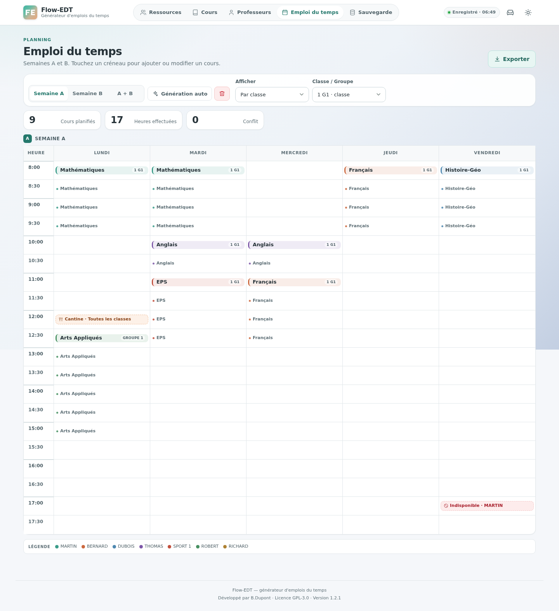
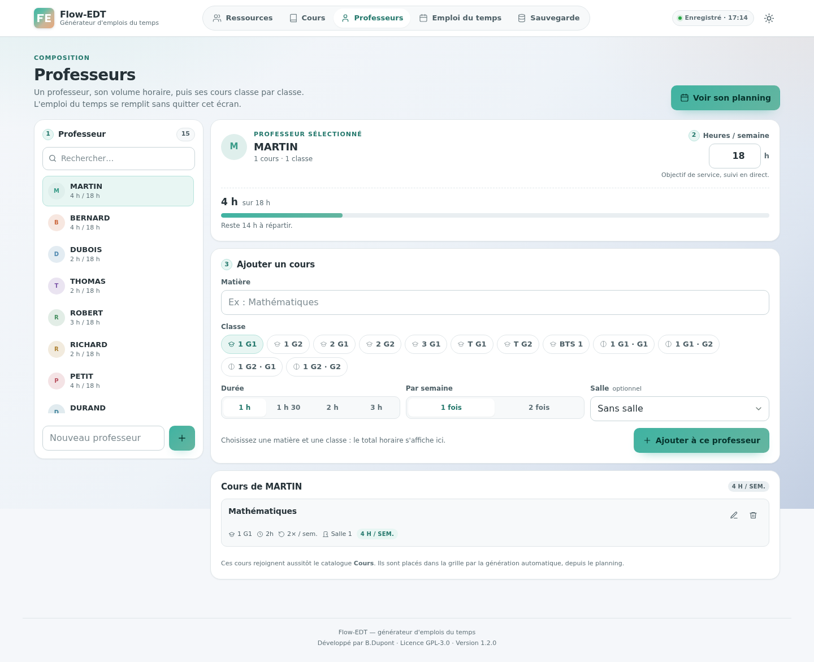

# Flow-EDT

Générateur d'emplois du temps pour établissement scolaire, en **un seul fichier HTML**, sans serveur, sans compte et sans dépendance.

[](LICENSE)
[](index.html)



## Sommaire

- [Fonctionnalités](#fonctionnalités)
- [Démarrage](#démarrage)
- [Génération automatique](#génération-automatique)
- [Données et sauvegarde](#données-et-sauvegarde)
- [Qualité](#qualité)
- [Structure du projet](#structure-du-projet)
- [Développement](#développement)
- [Licence](#licence)

## Fonctionnalités

**Ressources** — professeurs, salles, classes, demi-groupes et groupes de classes, avec volumes horaires et effectifs.

**Cours** — catalogue complet : classe, professeur, salle, nombre d'heures, semaines A/B, priorités, plages horaires interdites, durée et contraintes de salle dédiée.

**Professeurs** — un écran dédié pour composer un service sans quitter la page : choix du professeur, volume horaire hebdomadaire, puis ajout de ses cours classe par classe. Le planning se met à jour en direct.



**Emploi du temps** — grille 6 jours × créneaux, semaines A et B, vues globale, par professeur, par classe ou par salle. Détection des conflits en temps réel : un professeur, une classe ou une salle ne peuvent jamais être occupés deux fois au même créneau.

**Lisibilité des cours** — dans la grille, un cours seul s'affiche sur deux lignes (intitulé, puis professeur et salle) ; un cours à cheval sur deux créneaux garde sa bande de couleur sur toute la hauteur, pour lire le bloc de deux heures d'un seul tenant ; un créneau chargé montre deux cours au plus et un compteur « +N » (détail au survol et dans la fiche du créneau). Les intitulés ne sont jamais rognés verticalement.

**Confort de lecture** — mode compact des tableaux (mémorisé), bascule clair/sombre, export PDF et CSV, impression.

**Mobile** — menu burger, barre de navigation inférieure, feuilles modales, tableaux compacts ; toutes les fonctions restent accessibles en 390 px.

## Démarrage

1. Téléchargez `index.html` (ou clonez le dépôt).
2. Ouvrez-le dans un navigateur moderne : double-clic, ou `xdg-open index.html`.
3. Créez vos ressources puis vos cours — **l'application démarre totalement vide**, aucune donnée de démonstration.

Aucune installation, aucun serveur, aucune connexion réseau : tout s'exécute dans le navigateur.

<table>
<tr>
<td width="50%"></td>
<td valign="top">

**Compatibilité** — Chrome, Edge, Firefox et Safari récents. L'application est un fichier autonome ; les données restent sur le poste (aucun envoi).

**Accessibilité** — navigation clavier, rôles ARIA sur les onglets, les feuilles et les sélecteurs, libellés explicites et focus visible.

</td>
</tr>
</table>

## Génération automatique

Le bouton **Génération auto** (onglet Emploi du temps) ouvre une feuille de réglages : quatre curseurs de priorité — **Professeur**, **Salle**, **Classe**, **Priorité** — mémorisés dans le navigateur.

Le moteur place les cours semaine par semaine avec une heuristique gloutonne (contraintes dures : professeur, classe, salle, plages interdites, semaines A/B), puis améliore le résultat par recherche locale : échanges de créneaux qui réduisent les trous des professeurs et des classes, l'éloignement de la salle habituelle et l'ordre de priorité des cours.

Une seule génération peut tourner à la fois : le bouton reste désactivé pendant le calcul et toute nouvelle demande affiche « Une génération est déjà en cours ». Le résultat indique le nombre de cours placés, le volume horaire et les éventuels cours non placés.

## Données et sauvegarde

| Emplacement | Contenu |
|---|---|
| `localStorage` | Ressources, cours et plannings en cours, préférences (thème, compacité, priorités de génération) |
| `IndexedDB` | Emplois du temps nommés, conservés dans le navigateur |
| Onglet **Sauvegarde** | Export/import JSON, export CSV, export PDF, duplication et suppression des sauvegardes, réinitialisation complète |

L'import remplace l'intégralité des données : exportez régulièrement un fichier JSON.

## Qualité

| Contrôle | Commande | Résultat |
|---|---|---|
| Tests fonctionnels | `python3 .audit/functional.py` | 140 tests (navigation, ressources, cours, conflits, génération, verrou anti double lancement, sauvegarde, mobile) |
| QA visuelle | `python3 .audit/shot.py final` | 5 onglets × 3 tailles (390 / 900 / 1440 px) : 0 erreur console, 0 débordement horizontal |

## Structure du projet

```
FlowEDT/
├── index.html              application complète (fichier généré)
├── icon.svg                icône source
├── icon-16/32/180/192/512  favicons et icône iOS
├── LICENSE                 texte officiel GPL-3.0
├── NOTICE                  copyright et résumé de la licence
├── requirements-dev.txt    dépendances de développement
├── docs/                   captures d'écran du README
└── .audit/                 chaîne de fabrication et de contrôle
    ├── index.original.html base HTML d'origine
    ├── build/
    │   ├── body.html       onglets, feuilles, navigation
    │   ├── style.css       thème clair/sombre, responsive, compacité
    │   ├── impl.py         état, navigation, thème, densité, feuilles
    │   ├── impl2.py        rendu du planning, filtres, conflits, sauvegarde
    │   ├── impl3.py        générateur (glouton + recherche locale)
    │   └── patch.py        assemble index.html
    ├── functional.py       tests fonctionnels Playwright
    └── shot.py             captures et audits de mise en page
```

## Développement

`index.html` est **généré** : ne l'éditez pas à la main.

```bash
# 1. modifier les sources
$EDITOR .audit/build/style.css        # ou body.html, impl*.py

# 2. reconstruire l'application (idempotent)
python3 .audit/build/patch.py

# 3. contrôler
python3 .audit/functional.py          # 140/140 attendu
python3 .audit/shot.py final          # captures + rapport
```

Dépendances de développement (Python 3.10+) :

```bash
pip install -r requirements-dev.txt
python3 -m playwright install chromium
```

## Licence

Flow-EDT — générateur d'emplois du temps
Copyright (C) 2026 B.Dupont

Distribué sous licence **GNU General Public License v3.0** — texte officiel dans [LICENSE](LICENSE), copyright et résumé dans [NOTICE](NOTICE).
